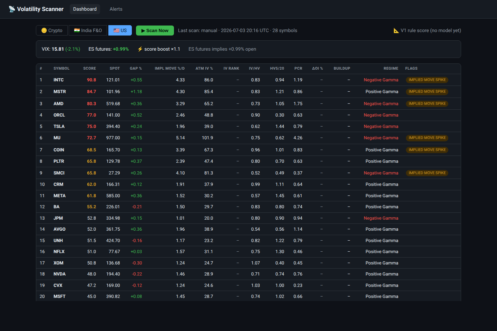

# quant_alert_1 — Cross-Market Pre-Market Volatility Scanner

Ranks the **Indian F&O**, **crypto**, and **US** universes by expected
volatility before each session opens, and pushes ranked digests plus
per-symbol risk alerts to **Telegram**, **Discord**, and a web dashboard.

Implements the full design described in [`article.md`](article.md):
**V1** (percentile composite score + threshold flags), **V1.5**
(India VIX / GIFT Nifty / ES-futures market context, earnings `EVENT_DAY`
override, futures OI buildup classification), and **V2** (real IV Rank
from accumulated history, self-training LightGBM ranker).



---

## 1. Prerequisites

- Python 3.10+ (built and tested on 3.12)
- Credentials in `~/quant_4/.env` (shared with the other quant apps;
  a local `.env` in this directory overrides any value):

  | Variable | Used for |
  |---|---|
  | `DHAN_CLIENT_ID`, `DHAN_ACCESS_TOKEN` | India option chains (Dhan API v2) |
  | `TELEGRAM_BOT_TOKEN`, `TELEGRAM_CHAT_ID` | Telegram alerts |
  | `DISCORD_WEBHOOK_URL` | Discord alerts |
  | `ENABLE_TELEGRAM`, `ENABLE_DISCORD` | channel kill-switches (`true`/`false`) |

  Binance and Yahoo Finance endpoints used here are public — no keys needed.

  > ⚠️ **Dhan tokens expire periodically** (error 808 / empty error
  > response). Refresh at [web.dhan.co](https://web.dhan.co) → profile →
  > Access DhanHQ APIs, and update `DHAN_ACCESS_TOKEN` in `~/quant_4/.env`.
  > India scans fail cleanly (run marked `failed`) until refreshed;
  > crypto and US are unaffected.

## 2. Install & run

```bash
cd ~/quant_alert_1
python3 -m venv venv
venv/bin/pip install -r requirements.txt

./run.sh                        # foreground
# or detached, surviving the terminal:
nohup venv/bin/python app.py > scanner.log 2>&1 & disown
```

Dashboard: **http://localhost:5051** (port set by `VOLSCAN_PORT`;
5050 belongs to the older `~/quant_alert`).

On startup the scheduler registers six jobs (all timezone-pinned, so DST
never shifts a scan relative to the open):

| Job | When |
|---|---|
| India pre-market scan | 09:07 IST Mon–Fri |
| India post-open rescan | 09:20 IST Mon–Fri |
| US pre-market scan | 09:10 America/New_York Mon–Fri |
| Crypto scan | every 30 min, 24/7 |
| V2 label backfill | 22:30 UTC nightly |
| V2 LightGBM retrain | Sunday 02:00 UTC |

First India scan downloads Dhan's instrument master once and caches the
F&O universe to `instance/fno_universe.csv` (refresh with
`scanner.universe.build_india_universe(force=True)`).

## 3. Using it

### Dashboard (`/`)

- One tab per market; **Scan Now** triggers a manual scan (button locks
  while one is running — concurrent requests get HTTP 409).
- The context card (V1.5) shows VIX level/change, the index-futures
  implied gap, and any active score boost.
- Columns include the V2 **IV Rank** (shows `–` until a symbol has 20 days
  of IV history) and the V1.5 **Buildup** classification. Hover a score to
  see its `score_v1` / `score_ml` decomposition.
- The badge in the top bar tells you which scorer is live:
  *"V1 rule score (no model yet)"* → *"🤖 ML score live (trained …, ρ …)"*.

### Alerts (`/alerts`)

Alert history with severity, delivery status (📨TG / 📨DC), and guidance
text. The same symbol + flag fires at most once per market per UTC day.

### HTTP API

| Route | Method | Purpose |
|---|---|---|
| `/api/scan/<MARKET>` | GET | latest scored results + run context (`INDIA`\|`CRYPTO`\|`US`) |
| `/api/scan/<MARKET>/run` | POST | manual scan; `?notify=false` to skip alerts; 202 started / 409 already running |
| `/api/alerts` | GET | recent alerts (`?market=` filter) |
| `/api/context/<MARKET>` | GET | live V1.5 market context (VIX, implied gap, multiplier) |
| `/api/ml/train` | POST | backfill labels + retrain the V2 model now |
| `/api/status` | GET | scheduler jobs, channel status, ML model status |

```bash
# manual crypto scan without sending alerts
curl -X POST "http://localhost:5051/api/scan/CRYPTO/run?notify=false"
# what does the model think of itself?
curl -s http://localhost:5051/api/status | jq .ml_model
```

## 4. The V2 model lifecycle

You don't have to do anything — it bootstraps itself:

1. Every scan stores a full feature snapshot (`features_json`) and the
   day's ATM IV (`iv_history`).
2. The nightly job labels each row with the realized next-session range —
   only from **completed** bars.
3. The weekly job trains once ≥ `ML_MIN_TRAINING_ROWS` (500) labeled rows
   exist, writes `instance/lgbm_ranker.txt` + metrics, and the very next
   scan starts blending (`score = 0.7·ml + 0.3·v1`).

Manual control:

```bash
venv/bin/python train_model.py            # backfill labels, then train
venv/bin/python train_model.py --labels   # labels only
```

Prints/records validation MAE and Spearman rank correlation
(`instance/lgbm_ranker.meta.json`). Delete the model file to fall back to
pure V1 instantly; set `USE_ML_SCORE=false` to disable permanently.

## 5. Configuration reference

Everything is an env var (in `~/quant_4/.env` or a local `.env`);
defaults in `config.py`.

| Variable | Default | Meaning |
|---|---|---|
| `VOLSCAN_PORT` | 5051 | Flask port |
| `INDIA_UNIVERSE_LIMIT` | 60 | F&O stocks scanned besides the 4 indices (~3.1 s each — budget ≈ limit × 3.1 s) |
| `CRYPTO_UNIVERSE_LIMIT` | 40 | top-N USDT perps by 24h volume |
| `CRYPTO_SCAN_INTERVAL_MIN` | 30 | crypto scan cadence |
| `MIN_SCORE_FOR_ALERT` | 60 | score gate for individual flag alerts |
| `TOP_N_ALERTS` | 10 | digest size |
| `GAP_ALERT_PCT` / `IMPLIED_MOVE_ALERT_PCT` | 2.0 / 3.0 | HIGH-flag thresholds |
| **V1.5** | | |
| `ENABLE_MARKET_CONTEXT` | true | master switch for context + boost |
| `GIFT_NIFTY_TICKER` | GIFTNIFTY.NS | no free feed exists — set one if you have it; failures just omit the implied gap |
| `VIX_HIGH_LEVEL` / `VIX_SPIKE_PCT` | 18 / 8 | context "hit" thresholds |
| `INDEX_GAP_ALERT_PCT` | 0.75 | implied index gap considered material |
| `CONTEXT_BOOST_PER_HIT` / `CONTEXT_MULT_MAX` | 0.10 / 1.30 | score multiplier per hit / cap |
| `ENABLE_EARNINGS` / `EVENT_DAY_LOOKAHEAD` | true / 1 | EVENT_DAY flag: earnings today or within N days |
| `BUILDUP_MIN_PRICE_PCT` / `BUILDUP_MIN_OI_PCT` | 0.25 / 2.0 | materiality floor for buildup classification |
| **V2** | | |
| `IV_RANK_MIN_OBS` | 20 | history days before IV Rank is trusted |
| `IV_RANK_LOOKBACK_DAYS` | 252 | IV Rank window |
| `IV_RANK_EXTREME_LEVEL` | 80 | IV_RANK_EXTREME threshold |
| `USE_ML_SCORE` | true | use the model when one exists |
| `ML_BLEND` | 0.7 | ML weight in the blend (1.0 = replace V1) |
| `ML_MIN_TRAINING_ROWS` | 500 | labeled rows required before training |
| `ML_AUTO_RETRAIN` | true | nightly labels + weekly retrain jobs |

## 6. Project layout

```
app.py                    Flask UI + JSON API
scheduler.py              APScheduler jobs + per-market scan locks
train_model.py            V2 training CLI
config.py                 all knobs; loads ~/quant_4/.env then local .env
models.py                 SQLAlchemy models (6 tables)
gamma_lite.py             BS gamma → regime + flip level
scanner/
  universe.py             universe builders (Dhan master / Binance / static US)
  scan_engine.py          orchestrates a run: context → collect → rank → score → persist → alert
  volatility_score.py     V1 percentile score, V1.5 buildup + flags, ML blend
  iv_rank.py              V2 IV Rank / percentile from iv_history
  ml_model.py             V2 LightGBM labels / training / prediction
data/
  dhan_client.py          globally paced Dhan wrapper (1 req / 3.1 s)
  india_market.py         Dhan chains + yfinance OHLCV features
  crypto_market.py        Binance FAPI/EAPI features
  us_market.py            yfinance chains + history features
  market_context.py       V1.5 VIX / GIFT Nifty / ES / BTC context
  earnings.py             V1.5 earnings calendar (day-cached)
alerts/
  alert_engine.py         digest + flag alerts, score gate, daily dedupe
  telegram_alert.py       Telegram bot sender
  discord_alert.py        Discord webhook sender (embeds)
templates/                dark dashboard + alert history
instance/                 volscan.db, fno_universe.csv, model files, caches
docs/screenshots/         dashboard captures used in article.md
```

## 7. Troubleshooting

| Symptom | Cause / fix |
|---|---|
| India runs marked `failed`, log shows Dhan error 808 or empty error | expired `DHAN_ACCESS_TOKEN` — refresh at web.dhan.co |
| `GIFTNIFTY.NS possibly delisted` warnings | expected: Yahoo has no GIFT Nifty; harmless, context omits the gap (set `GIFT_NIFTY_TICKER` if you have a feed) |
| India scan slow | by design — Dhan allows ~1 chain req / 3 s; lower `INDIA_UNIVERSE_LIMIT` |
| IV Rank column all `–` | normal for the first ~20 trading days per symbol while `iv_history` accumulates |
| `[ML] not training — only N labeled rows` | normal until ~500 labeled rows (≈ a week of all-market scans + label lag) |
| No Telegram/Discord messages | check `/api/status` → `channels`; verify token/webhook and `ENABLE_*` flags |
| Second scan returns 409 | intentional — one scan per market at a time |
| Scores all shifted up ~10–30% one morning | look at the context card: a VIX spike or big implied index gap applied the V1.5 multiplier |

Logs go to `scanner.log` when run detached; each scan prints per-symbol
progress, context notes, and the scorer used.
