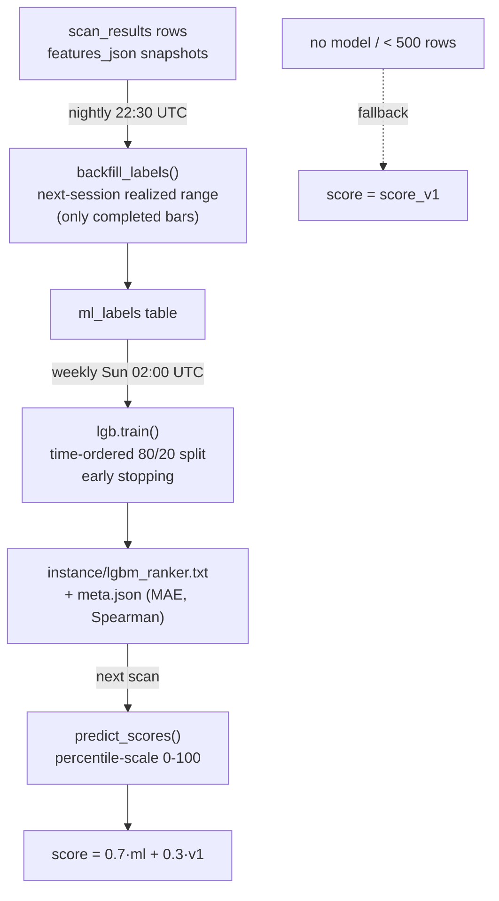
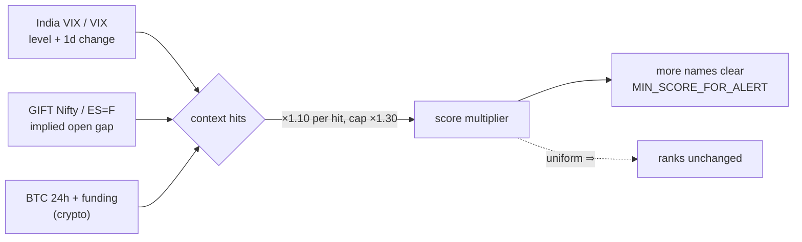
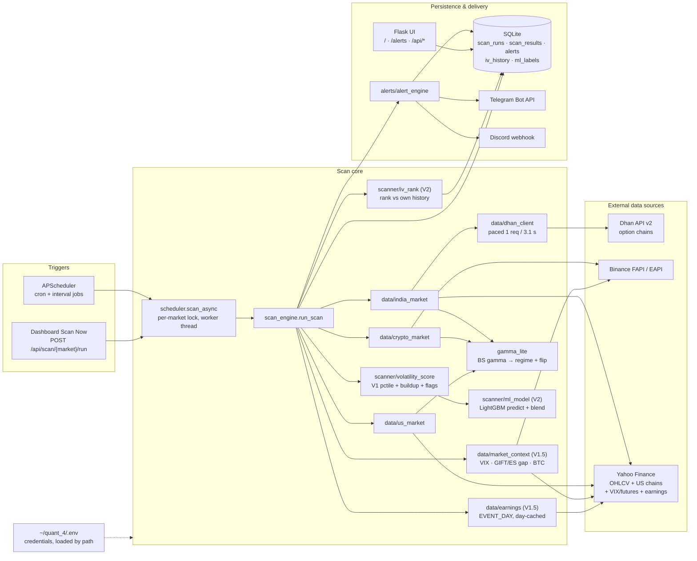
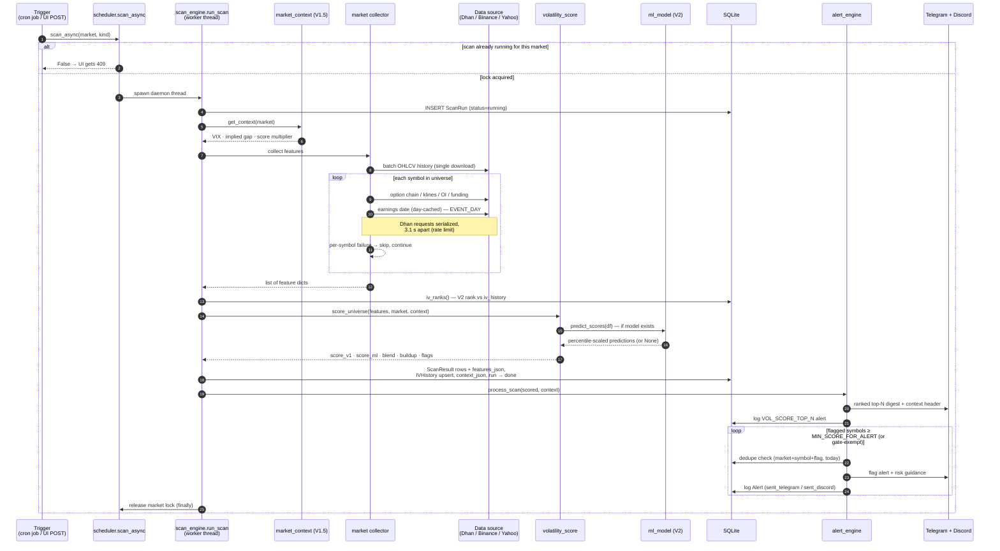
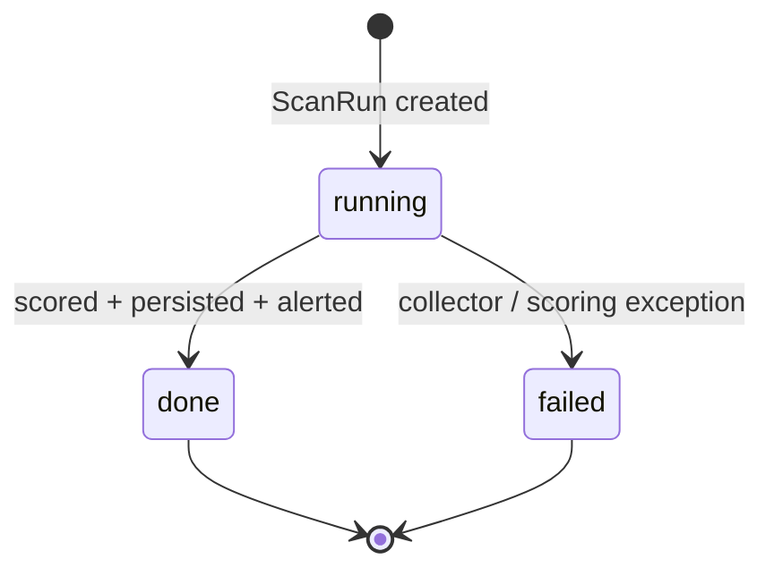
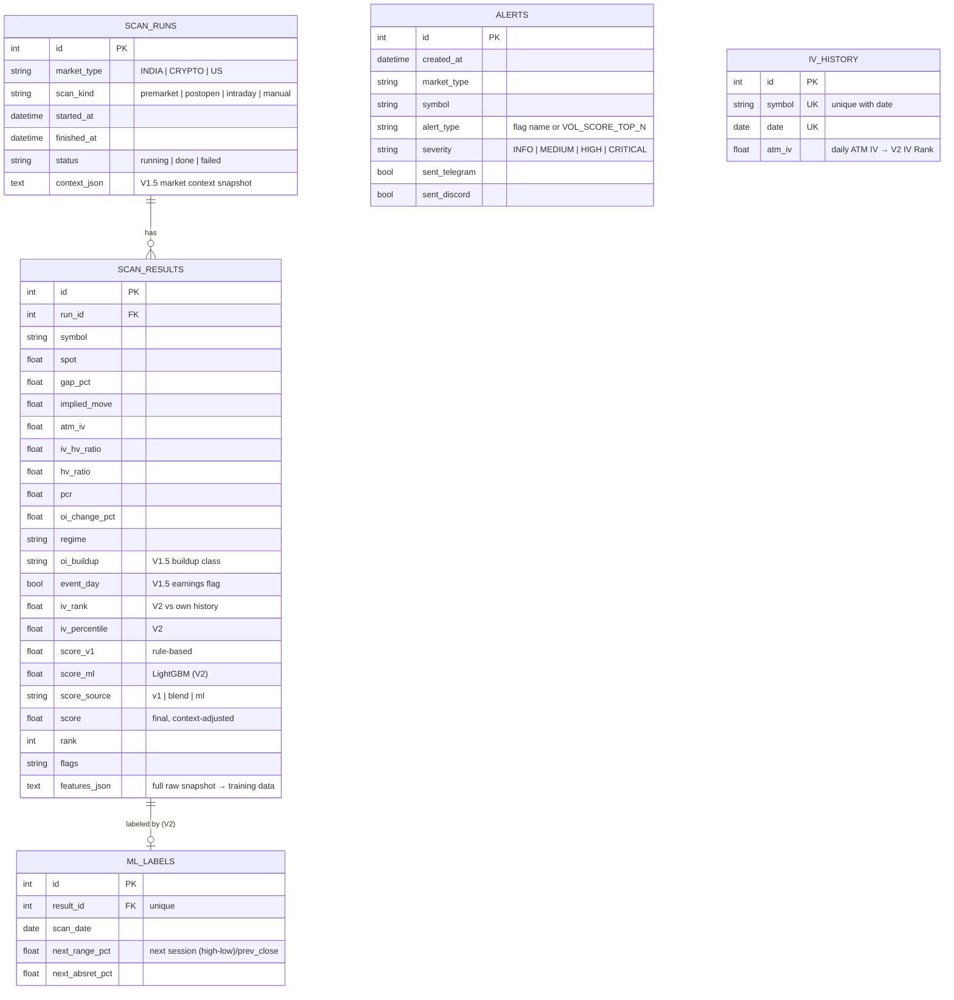
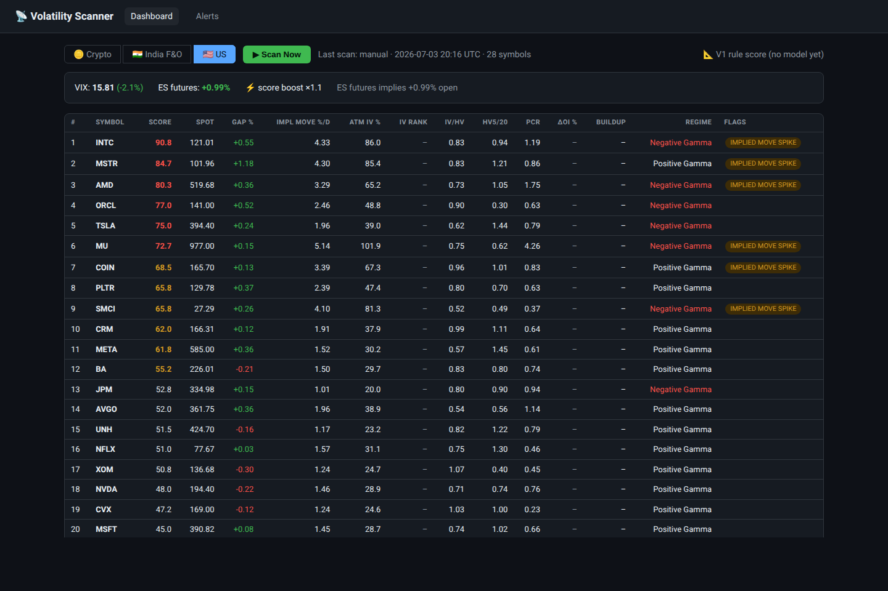
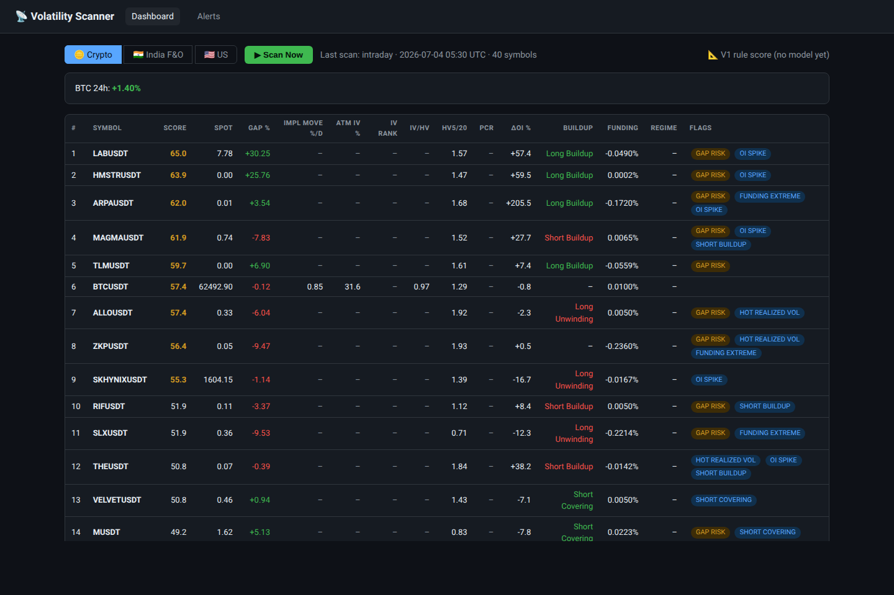
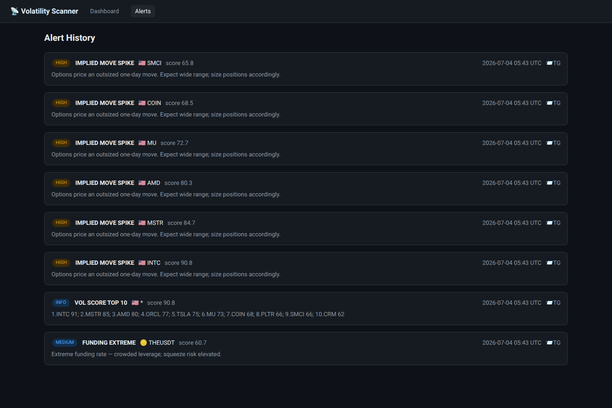

# A Cross-Market Pre-Market Volatility Scanner, from Rules to ML

*How `quant_alert_1` came together: a Flask app that ranks Indian F&O,
crypto, and US universes by expected volatility every morning and pushes
ranked digests to Telegram, Discord, and a web dashboard — now with
market-level context (V1.5) and a self-training LightGBM ranker (V2).*

---

## The problem

Most retail alerting tools poll one symbol at a time during the session and
tell you what already happened. The goal here is the opposite: a
**cross-sectional pre-market scan** that answers, before the open,
*"which names are likely to move violently today?"* — not as directional
calls, but as risk-awareness alerts ("expect a wide range, size down, use
wider stops, avoid market orders at the open").

Three markets, three very different data stacks:

| Market | Universe | Data source | Schedule |
|---|---|---|---|
| India  | 4 indices + top F&O stocks (~226 available, top 60 scanned) | Dhan API v2 option chains + yfinance OHLCV | 09:07 + 09:20 IST Mon–Fri |
| Crypto | Top-40 USDT perpetuals by 24h volume | Binance FAPI (perps) + EAPI (BTC/ETH/BNB options) | every 30 min, 24/7 |
| US     | 28 liquid tickers (SPY, QQQ, mega-caps…) | yfinance chains + history | 09:10 ET Mon–Fri |

The project extends the original `quant_alert` V1 build (itself built on
`~/quant_4`'s Dhan/Binance/Telegram/Discord credentials and Black-Scholes
gamma math), and implements what was previously just the roadmap:
**V1.5** (market-level context, earnings overrides, OI buildup
classification) and **V2** (a real IV Rank and a LightGBM model that learns
to predict next-day ranges from the scanner's own logged history).

## Signal design

Each symbol gets one feature row per scan, drawn from three signal families:

**Options-derived**

- **Straddle-implied move** — ATM call + put premium over spot is the
  market's priced expected move to expiry; dividing by √(days-to-expiry)
  normalizes it to a comparable 1-day number across expiries.
- **ATM IV** and the **IV/HV ratio** — implied vol versus 20-day realized
  vol. A ratio well above 1 means options are pricing something realized
  vol hasn't shown yet (an event, a repricing).
- **PCR** (put/call OI ratio) and **gamma regime**. The gamma regime
  (Positive/Negative) plus the flip level comes from cumulative signed
  gamma exposure across the chain: negative-gamma names gap harder because
  dealer hedging amplifies moves instead of damping them.

**Price/realized-vol derived (OHLCV)**

- **Gap %** vs the previous session close.
- **HV5/HV20 ratio** — short realized vol running hot against its baseline.
- **ATR%** and **distance to the 52-week high/low** (breakout proximity).

**Positioning**

- Total chain **open interest** and, for India, the **overnight ΔOI** —
  Dhan chain legs carry `previous_oi`, so one fetch yields the change.
- Crypto extras: **funding rate** (crowded-side proxy) and **24h OI change**
  from Binance futures data.
- **V1.5: futures OI buildup** — the classic price × OI decomposition
  (below).

### V1.5: futures OI buildup classification

Price direction crossed with OI direction reads positioning intent
directly. Both legs must clear a materiality floor
(`BUILDUP_MIN_PRICE_PCT` = 0.25%, `BUILDUP_MIN_OI_PCT` = 2%) or the cell
stays unclassified:

|  | **OI rising** | **OI falling** |
|---|---|---|
| **Price up**   | Long Buildup (new longs, conviction) | Short Covering (squeeze fuel, often short-lived) |
| **Price down** | Short Buildup (fresh shorts, continuation risk) | Long Unwinding (longs exiting) |

India uses the overnight ΔOI from the chain; crypto uses the 24h perp OI
change. `SHORT_BUILDUP` and `SHORT_COVERING` also fire as alert flags —
the two states most likely to precede violent continuation or reversal.
A live scan caught all four states at once:

```
 1 ZKPUSDT   gap +31.0%  ΔOI  +92.2%  → Long Buildup
 3 TLMUSDT   gap +65.9%  ΔOI  -19.7%  → Short Covering
 5 LABUSDT   gap -45.7%  ΔOI  +50.9%  → Short Buildup
 6 BIRBUSDT  gap -14.3%  ΔOI  -19.9%  → Long Unwinding
```

### V1.5: earnings `EVENT_DAY` override

The single most predictable volatility catalyst is a scheduled one.
`data/earnings.py` asks yfinance for each symbol's next earnings date
(cached per calendar day in `instance/earnings_cache.json` so the
premarket, post-open, and manual scans don't refetch), and any name
reporting today or within `EVENT_DAY_LOOKAHEAD` days gets:

- an `EVENT_DAY` flag (severity HIGH) with event-specific guidance, and
- an **exemption from the alert score gate** — an earnings name alerts
  even on an otherwise quiet tape, exactly like the critical
  `NEGATIVE_GAMMA_GAP`.

Indices are skipped (no earnings); crypto has no calendar.

## Scoring: three layers, one number

### Layer 1 — V1 percentile score

Raw features live on wildly different scales (an implied move in percent,
an OI change in tens of percent, a PCR near 1). The V1 composite sidesteps
unit problems entirely: every feature is converted to its
**cross-sectional percentile rank within the day's universe** (missing
values pinned to a neutral 0.5), then combined as a weighted sum scaled
0–100:

```python
SCORE_WEIGHTS = {
    "implied_move": 0.30, "gap_pct": 0.20, "iv_hv_ratio": 0.15,
    "hv_ratio": 0.15, "oi_change": 0.10, "negative_gamma": 0.10,
}
```

### Layer 2 — V2 LightGBM blend (when a model exists)

Every scan has always snapshotted its full feature dict to a
`features_json` column — deliberately, as future training data. V2 closes
that loop:

- A nightly job labels each logged row with the **realized next-session
  range** ((high − low) / previous close, in %) once that session has
  actually closed — yfinance for India/US, Binance klines for crypto.
- A weekly job trains a LightGBM regressor on features → next-day range,
  with a **time-ordered validation split** (never shuffled — that would
  leak tomorrow into today) and reports validation MAE and Spearman rank
  correlation.
- At scan time the model's predicted range is percentile-scaled 0–100
  within the scan (the same scale as V1) and blended:

```
score = ML_BLEND × score_ml + (1 − ML_BLEND) × score_v1        # default 0.7 / 0.3
```

The fallback chain is fully automatic: no LightGBM installed, no model
file, or fewer than `ML_MIN_TRAINING_ROWS` (500) labeled rows → pure V1
scoring, and the dashboard badge says so. Both `score_v1` and `score_ml`
are persisted per row, so the blend is always auditable.



### Layer 3 — V1.5 market-context multiplier

A symbol-level score can't see that *the whole tape* is about to be fast.
Before each scan, `data/market_context.py` builds a market snapshot:

| Market | Vol gauge | Implied open |
|---|---|---|
| India  | **India VIX** (level + 1-day change) | **GIFT Nifty** vs NIFTY previous close |
| US     | **VIX** | **ES futures** vs SPX previous close |
| Crypto | — | **BTC 24h change** + BTC funding |

Each contextual "hit" — VIX above `VIX_HIGH_LEVEL` (18), VIX 1-day change
above `VIX_SPIKE_PCT` (+8%), index futures implying a gap ≥
`INDEX_GAP_ALERT_PCT` (0.75%) — multiplies **every** symbol's score by
`CONTEXT_BOOST_PER_HIT` (×1.10 each, capped at ×1.30). The multiplier is
uniform, so **ranks never change** — what changes is how many names clear
the `MIN_SCORE_FOR_ALERT` gate. That's the point: on a +2% GIFT Nifty
morning with India VIX spiking, you want the 12th-ranked name to alert
too, not just the top 10. The context is stamped on the digest header, the
dashboard card, and `scan_runs.context_json` for the audit trail.



A real morning, from the live system — ES futures implying a +0.99% SPX
open pushed every US score up 10%:

```json
{"vix": 15.81, "vix_change_pct": -2.1, "implied_gap_pct": 0.986,
 "gap_source": "ES futures", "score_multiplier": 1.1,
 "context_notes": ["ES futures implies +0.99% open"]}
```

### Flags

On top of the continuous score, hard-threshold **flags** fire per symbol,
each carrying risk-guidance text rather than a trade direction:

| Flag | Severity | Trigger |
|---|---|---|
| `NEGATIVE_GAMMA_GAP` | CRITICAL | gap ≥ 1% into negative dealer gamma (gate-exempt) |
| `GAP_RISK` | HIGH | \|gap\| ≥ 2% |
| `IMPLIED_MOVE_SPIKE` | HIGH | implied 1-day move ≥ 3% |
| `EVENT_DAY` | HIGH | earnings today/imminent (V1.5, gate-exempt) |
| `IV_RANK_EXTREME` | MEDIUM | **V2:** IV Rank ≥ 80 (falls back to IV/HV ≥ 1.5 until history builds) |
| `HOT_REALIZED_VOL` | MEDIUM | HV5/HV20 ≥ 1.8 |
| `OI_SPIKE` | MEDIUM | \|ΔOI\| ≥ 15% |
| `SHORT_BUILDUP` / `SHORT_COVERING` | MEDIUM | V1.5 buildup classification |
| `FUNDING_EXTREME` | MEDIUM | \|funding\| ≥ 0.08% (crypto) |

### V2: a real IV Rank

"IV is 45" means nothing without knowing whether that's high *for this
name*. V1 approximated with the IV/HV ratio; V2 computes the real thing
from the scanner's own accumulated history. Every scan upserts each
symbol's ATM IV into `iv_history` (unique on symbol + date); once a symbol
has `IV_RANK_MIN_OBS` (20) days on record:

```
iv_rank       = (IV_today − min) / (max − min) × 100     over IV_RANK_LOOKBACK_DAYS (252)
iv_percentile = % of history days with IV below today's
```

Today's row is excluded from its own history, both numbers ride along as
model features, and `IV_RANK_EXTREME` switches from the IV/HV heuristic to
the real rank — per symbol, automatically, as each name crosses 20
observations. The dashboard's IV Rank column shows `–` until then; no
false precision.

## Architecture

*(Diagrams are [Mermaid](https://mermaid.js.org/) — they render inline on
GitHub and in most markdown viewers. Pre-rendered SVG copies for platforms
that don't render Mermaid live in [`docs/diagrams/`](docs/diagrams/):
`architecture`, `scan-sequence`, `scanrun-states`, `data-model`,
`ml-pipeline`, `context-flow`. After editing a diagram here, regenerate
them with `docs/render_diagrams.sh`.)*

### High-level view



### Module layout

```
app.py (Flask + SQLite)
 ├── scheduler.py              APScheduler jobs, per-market run locks,
 │                             V2 nightly label + weekly retrain jobs
 ├── train_model.py            V2 training CLI (labels + train)
 ├── scanner/
 │    ├── universe.py          Dhan instrument master → F&O universe CSV
 │    ├── scan_engine.py       orchestrates a scan run, persists results
 │    ├── volatility_score.py  V1 pctile score + V1.5 buildup + flags + ML blend
 │    ├── iv_rank.py           V2 IV Rank / percentile from iv_history
 │    └── ml_model.py          V2 LightGBM: labels, training, prediction
 ├── data/
 │    ├── dhan_client.py       globally paced Dhan wrapper (1 req / 3.1 s)
 │    ├── india_market.py      Dhan chains + yfinance OHLCV features
 │    ├── crypto_market.py     Binance FAPI/EAPI features
 │    ├── us_market.py         yfinance chains + history features
 │    ├── market_context.py    V1.5 VIX / GIFT Nifty / ES / BTC context
 │    └── earnings.py          V1.5 EVENT_DAY calendar, day-cached
 ├── alerts/                   telegram_alert.py, discord_alert.py, alert_engine.py
 └── templates/                dark-theme dashboard + alert history
```

Scheduling is timezone-explicit — the India jobs are cron-pinned to
`Asia/Kolkata` and the US job to `America/New_York`, so DST never shifts
the scan relative to the open:

- **India pre-market** 09:07 IST Mon–Fri (after the 09:00–09:07 pre-open
  auction, when chains reflect overnight IV repricing) and a **post-open
  rescan** at 09:20 IST with the actual opening print.
- **US pre-market** 09:10 ET Mon–Fri.
- **Crypto** every 30 minutes, 24/7.
- **V2 label backfill** nightly 22:30 UTC; **V2 retrain** Sunday 02:00 UTC.

Manual scans run via a **Scan Now** button (or `POST /api/scan/<MARKET>/run`)
on a worker thread guarded by a per-market lock — a second request while a
scan is running gets a 409, not a duplicate run.

### Scan lifecycle — sequence

One scan, from trigger to delivered alerts (identical for scheduled and
manual runs — both funnel through `scheduler.scan_async`):



A `ScanRun` row tracks each pass through a tiny state machine — any
exception in collection or scoring marks the run `failed` rather than
leaving it dangling:



## Data model

Six tables in SQLite (Flask-SQLAlchemy). `scan_results` is deliberately
wide — one denormalized feature row per symbol per scan, plus the complete
raw snapshot in `features_json`; that column is what the V2 model trains
on. Only the key columns are shown here:



`alerts` doubles as the dedupe store — `_already_sent_today()` queries it
by market + symbol + alert_type + UTC day before sending. `iv_history` is
upserted once per symbol per day; `ml_labels` is written once per result
row, only after the following session has closed.

## What it looks like

### Dashboard

The US tab after a live scan — note the V1.5 context card (VIX 15.81, ES
futures +0.99% → score boost ×1.1), the V2 IV Rank column (still `–`,
history is building), and the score-source badge top-right honestly
reporting "V1 rule score (no model yet)":



The crypto tab, where the V1.5 buildup column earns its keep — all four
classifications live in one scan, with the flags to match:



### Alert history



### Telegram digest (verbatim from the live system)

```
📋 PRE-MARKET VOLATILITY SCAN 🇺🇸 US
Top 10 by expected-volatility score

VIX: 15.81 (-2.1%)
ES futures: +0.99%
⚡ risk context boost ×1.1 — ES futures implies +0.99% open

 # SYMBOL       SCORE   GAP%  IMPL% IVR FLAGS
 1 INTC          90.8   +0.5    4.3   – IMPLIEDMOVESPIKE
 2 MSTR          84.7   +1.2    4.3   – IMPLIEDMOVESPIKE
 3 AMD           80.3   +0.4    3.3   – IMPLIEDMOVESPIKE
 4 ORCL          77.0   +0.5    2.5   –
 5 TSLA          75.0   +0.2    2.0   –
 6 MU            72.7   +0.1    5.1   – IMPLIEDMOVESPIKE
 7 COIN          68.5   +0.1    3.4   – IMPLIEDMOVESPIKE
 8 PLTR          65.8   +0.4    2.4   –
 9 SMCI          65.8   +0.3    4.1   – IMPLIEDMOVESPIKE
10 CRM           62.0   +0.1    1.9   –

Risk guidance: high-score names → expect wide ranges; size down,
use wider stops, avoid market orders at the open.
```

### Individual flag alert

```
📊 SHORT COVERING 🪙 TLMUSDT

Price up on falling OI — shorts exiting; sharp but potentially
short-lived upside bursts.

Spot:         0.00   ← sub-cent perp; 2-dp formatting
Gap:          65.90%
Implied Move: N/A
ATM IV:       N/A
IV Rank:      building history
IV/HV:        N/A
HV5/HV20:     1.67
Regime:       N/A
OI Buildup:   Short Covering
Vol Score:    63.3/100 (v1)
```

Discord receives the same content as color-coded embeds (crimson for
CRITICAL, orange HIGH, blue MEDIUM) with inline fields.

## The engineering problems worth writing down

### 1. Dhan's 1-request-per-3-seconds option-chain limit

Dhan's option-chain endpoint allows one unique request every 3 seconds. The
fix is a single global choke point: `dhan_client.py` wraps every call in a
`threading.Lock` plus a paced 3.1 s gap, so no matter how many code paths
ask for chains, requests are serialized and spaced. The consequence is a
hard scan-time budget — the full 226-stock universe would take ~12 minutes —
so `INDIA_UNIVERSE_LIMIT` (default 60) caps the scan to the 4 indices plus
the most liquid names first, keeping a pre-market scan under ~4 minutes.

The universe itself is built from Dhan's instrument master CSV: `FUTSTK`
rows identify every F&O underlying (with lot sizes), equity rows supply the
security IDs the option-chain API needs, and the result is cached to
`instance/fno_universe.csv`. A runtime fallback retries a failing chain
request on the alternate segment (`NSE_FNO` ↔ `NSE_EQ`), since a few
underlyings answer on the "wrong" one.

### 2. Yahoo's per-leg IVs are junk when you need them most

The scanner runs pre-market — exactly when yfinance's per-leg
`impliedVolatility` fields are degenerate. Inspection showed quantized
garbage (values like 0.0313 repeated across the whole chain) on 0DTE and
pre-market chains, producing "ATM IV" readings of 0.05%. The fix was to
stop trusting per-leg IVs entirely and derive ATM IV from the one thing
that *is* real: the traded ATM straddle price, via the
**Brenner–Subrahmanyam approximation**:

```
σ ≈ straddle / (0.8 · S · √T)
```

The chain-median fallback only applies when there is no straddle print at
all. Result: NVDA came back at 34.5% instead of 0.78%. This matters twice
over in V2: those ATM IVs are what `iv_history` accumulates, so garbage in
would have meant a garbage IV Rank forever.

### 3. "Gap %" that was always zero

Two subtle data bugs compounded here. During market hours, yfinance's daily
history ends with **today's partial bar**, so "previous close" was actually
the live price — gap ≡ 0. And when the market is closed, `fast_info`'s
last price *equals* the last close — gap ≡ 0 again. The fix:
`price_features()` drops the final bar whenever its date is today, and the
US spot lookup prefers `tk.info`'s `preMarketPrice` / `postMarketPrice` /
`regularMarketPrice` before falling back to `fast_info` and then history.
Sanity filters discard "gaps" beyond 20% (India) / 25% (US) as stale-data
artifacts.

### 4. The still-forming bar almost poisoned the training labels

The V2 label is "the next session's realized range" — which sounds
unambiguous until you notice that Binance's daily kline for *today* exists
all day long, growing. The first labeling pass happily used it: a scan
from yesterday would get labeled with a bar that was only hours old, and
the nightly 22:30 UTC job would systematically record ranges ~10% too
small (the day wasn't finished). The fix is a `complete_before` cutoff in
`_label_from_hist()`: crypto bars only count once the UTC day has rolled
over; stock bars only once their date is strictly in the past. A label is
written exactly once and never from a bar that's still trading. The same
class of bug as #3 — *the last row of any daily feed is a lie until the
day ends* — just wearing a different hat.

### 5. Secrets stay out of the transcript

The credentials live in `~/quant_4/.env` and were never printed. The
convention (kept as persistent project memory): inspect variable *names*
only (`grep -oE '^[A-Za-z_]+' .env`) and let the app load values by path —
`config.py` calls `load_dotenv()` on `~/quant_4/.env` first, with a local
`.env` able to override any value.

### 6. Crypto implied moves without a real options market per alt

Binance only lists options on BTC, ETH, and BNB. So the crypto scan takes
implied moves from the EAPI mark-price endpoint (nearest-expiry ATM
straddle + `markIV`) for those three, and leans on the realized-vol,
funding, OI-change, and buildup features for the rest of the perp
universe. A per-scan cache avoids refetching the options mark table for
each symbol.

### 7. GIFT Nifty has no free feed — degrade, don't break

GIFT Nifty (the offshore Nifty futures that replaced SGX Nifty) trades on
NSE IX, which has no stable free API, and Yahoo doesn't carry it. Rather
than scrape something fragile into a pre-market critical path, the ticker
is a config knob (`GIFT_NIFTY_TICKER`) and every context fetch is
failure-tolerant: a dead feed produces a context with `implied_gap_pct:
null` and the scan proceeds with whatever context *is* available (India
VIX still works via `^INDIAVIX`). The same graceful-degradation shape as
the ML fallback: a missing enhancement must never cost the baseline scan.

### 8. Keeping the ML dependency honest

LightGBM's familiar `LGBMRegressor` interface quietly requires
scikit-learn — a heavy transitive dependency that failed to install on a
flaky network mid-build. But the prediction path already used the native
`lgb.Booster` API, which needs nothing extra; only training used the
sklearn wrapper. Rewriting `train()` against native `lgb.train()` +
`lgb.Dataset` (same params, same early stopping) dropped the dependency
entirely. Fewer moving parts in the weekly retrain job that has to work
unattended at 2 a.m.

## Verification status

- **Crypto**: fully verified live — 40-symbol scans persisting every 30
  minutes, all four OI-buildup classes observed simultaneously (ZKP +31%
  gap on +92% OI = Long Buildup; LAB −45.7% on +51% OI = Short Buildup),
  and 20 consecutive digests confirmed delivered to **both** Telegram and
  Discord overnight.
- **US**: 28 symbols scored; the ES-futures context (+0.99% implied open)
  correctly multiplied every persisted score by 1.1; earnings lookups
  verified (NVDA → 2026-08-27); ATM IVs sane (INTC 86%, MU 102% — memory
  names into earnings season).
- **V2 pipeline**: exercised end-to-end on synthetic data — 400 labeled
  rows trained to validation Spearman 0.936, model file loaded at scan
  time, blend applied, then deleted so production genuinely starts on V1
  and upgrades itself as real labels accumulate.
- **India**: the code path mirrors the proven Dhan usage, but the access
  token in `~/quant_4/.env` was expired at build time (Dhan error 808), so
  the live India scan awaits a token refresh at web.dhan.co. Dhan tokens
  expire periodically; this is a recurring chore.

The app runs detached (`nohup … & disown`) so it survives terminal
sessions, serving the dashboard at `http://localhost:5051`.

## What's next

- **Walk-forward evaluation** — once a few months of `ml_labels` exist,
  compare the blend against pure V1 on held-out weeks before raising
  `ML_BLEND` past 0.7 (or to 1.0, retiring the hand weights entirely).
- **Per-market models** — one global model with market one-hots is right
  for small data; split when each market has thousands of labeled rows.
- **A real GIFT Nifty feed** — the one V1.5 input still stubbed by a
  config knob.
- **Intraday India rescans** — the 09:20 post-open rescan catches the
  opening print; a 13:00 IST pass would catch afternoon OI shifts.

---

*Stack: Python 3, Flask + Flask-SQLAlchemy (SQLite), APScheduler,
dhanhq 2.0.2, yfinance, pandas/numpy/scipy, LightGBM (native API),
Binance FAPI/EAPI, Telegram Bot API, Discord webhooks.*
